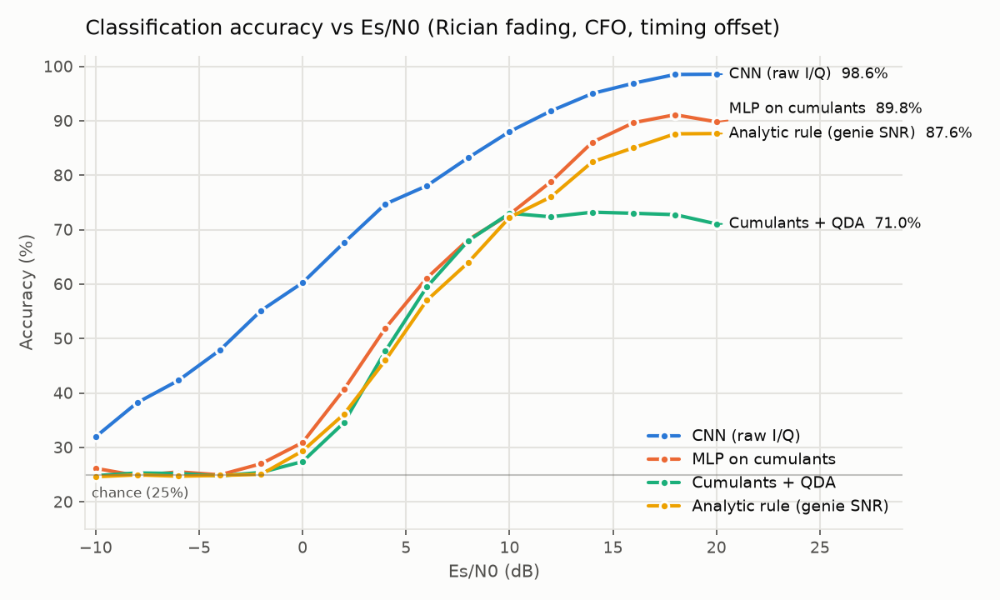

# Signal

**Automatic modulation classification from raw I/Q samples: a 1-D residual CNN (PyTorch) compared
against classical higher-order-cumulant classifiers (NumPy/SciPy).** The four classes are BPSK,
QPSK, 16-QAM and 64-QAM, and the synthetic channel has noise, fading, frequency and timing errors.
[REPORT.md](REPORT.md) documents where the learned model helps and where it does not, with the
AI-native air interfaces proposed for 6G in mind.

## Results



| Method | Accuracy at Es/N0 = 10 dB | Mean, Es/N0 0–20 dB |
|---|---:|---:|
| **CNN (raw I/Q)** | **88.0%** | **84.8%** |
| MLP on cumulants | 72.8% | 69.2% |
| Cumulants + QDA | 73.0% | 61.1% |
| Analytic rule (given the true SNR) | 72.2% | 65.8% |

The CNN passes 90% from 12 dB (91.8%) and reaches 98.6% at 20 dB. Its expected calibration error
is 0.007. The test set has 2,000 frames per Es/N0, generated from a separate seed.

**Where the CNN helps:** it leads at every SNR and needs roughly 7 dB less SNR for the same
accuracy. With 128 samples it beats the classical methods at 1024. It separates 16QAM from 64QAM
far better, and it holds up at least as well under fading conditions it was not trained on.

**Where it does not:**

- With a frequency offset 10× beyond its training range, it loses its whole lead; the classical
  front end removes the offset and is unaffected.
- On an unseen modulation (8PSK) it answers "QPSK" 99.3% of the time, with 0.991 confidence.
  Its softmax cannot flag the frame (AUROC 0.411), while the QDA likelihood can (0.960).
- It needs 4,000 to 16,000 training frames just to match a 144-parameter model.
- It costs 52.7 M multiply-accumulates per frame, against about 1 M operations.

[REPORT.md](REPORT.md) has every experiment, the tables behind each figure, and what the results
suggest for AI-native air interfaces. It also covers the first training run, which overfitted a
fixed dataset (82.6% at 10 dB), and the fix: a new dataset for every epoch.

## The dataset

Every frame is 1024 complex baseband samples at 2 samples per symbol (512 symbols), built as:

```
random symbols ─► root-raised-cosine pulse shaping (β = 0.35) ─► random fractional timing offset
  ─► flat Rician fading, K ~ U[0, 10] dB, Doppler ~ U[0, 2e-4]·fs (sum-of-sinusoids model)
  ─► residual carrier frequency offset ~ U[±1e-3]·fs and a random phase
  ─► complex AWGN at Es/N0 ∈ {−10, −8, …, 20} dB
```

SNR is quoted as **Es/N0 (energy per symbol)**. That is about 3 dB harder than the per-sample
SNR some datasets quote at 2 samples per symbol. Everything is generated from seeds, so every
number in the report can be reproduced exactly.

## The models

| Model | Input | Trainable parameters | Notes |
|---|---|---:|---|
| **CNN** | raw I/Q (2 × 1024) | 399,108 | Stride-2 stem, 5 residual 1-D conv blocks, mean+max pooling; per-frame RMS normalisation; any frame length |
| **MLP on cumulants** | 7 hand-crafted features | 4,932 | Same features as QDA, learned decision rule |
| **Cumulants + QDA** | 7 hand-crafted features | 144 | One Gaussian per class |
| **Analytic rule** | \|C40\|, C42 | 0 | Nearest textbook cumulant value, given the true SNR ("genie") |

The classical pipeline is a fair one. It estimates and removes the frequency offset blindly (the
spectral line of x⁴), matched-filters with the known pulse, recovers symbol timing with the
maximum-output-energy criterion, and computes symbol-rate cumulants (|C20|, |C40|, |C41|, C42,
|C60|, C63) plus an M2M4 SNR estimate. With that front end, noise-free cumulants match the
textbook values (unit tests check C42 within 0.04).

## Reproduce

```bash
python -m venv .venv && . .venv/bin/activate
pip install -e ".[test]"
pytest                                   # 30 unit tests: channel physics, features, model, metrics
python scripts/run_experiments.py        # all experiments
python scripts/make_tables.py            # the tables in REPORT.md, rendered from results/results.json
python scripts/make_figures.py           # redraw figures/ from the saved results
python scripts/cpu_latency_sweep.py      # CPU time per frame across batch sizes
```

`--quick` runs the whole pipeline with tiny sizes in seconds (CI does this on every push).
`results/results.json` holds every number in the report, and `models/amcnet.pt` is the trained CNN.

## Layout

```
amc/modulation.py   constellations, theoretical cumulants
amc/channel.py      RRC pulse shaping, timing offset, Rician/Rayleigh fading, CFO, AWGN
amc/dataset.py      dataset generator (fixed sets, balanced test grids, fresh-per-epoch data)
amc/features.py     cumulants, blind CFO / timing / SNR estimation
amc/baselines.py    cumulant QDA, cumulant MLP, analytic rule
amc/model.py        the CNN
amc/train.py        training loop
amc/evaluate.py     accuracy per SNR, confusion, calibration, OOD AUROC, latency
amc/figures.py      every report figure, drawn from results/
amc/plots.py        plotting primitives (validated colour order, direct labels)
scripts/            experiment runner, table and figure generators
```

## License

MIT, see [LICENSE](LICENSE).
