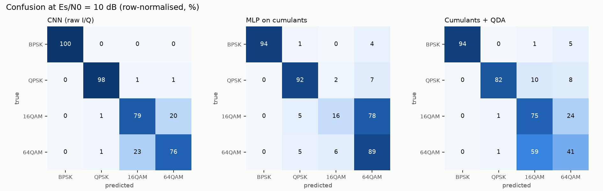
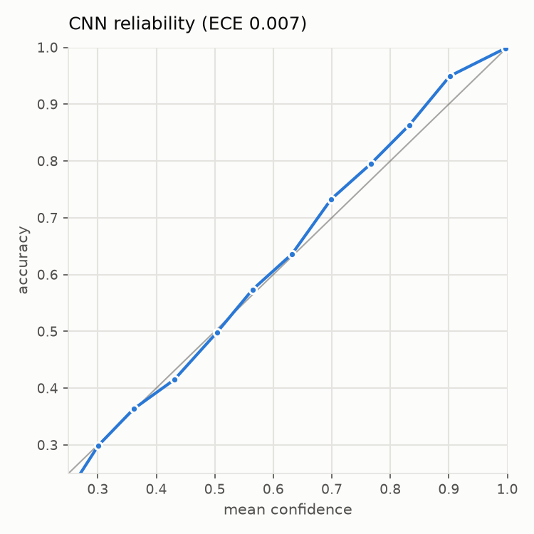
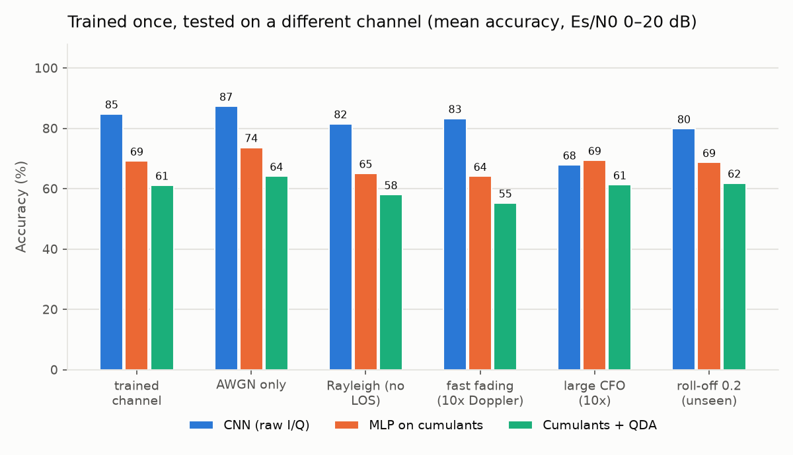
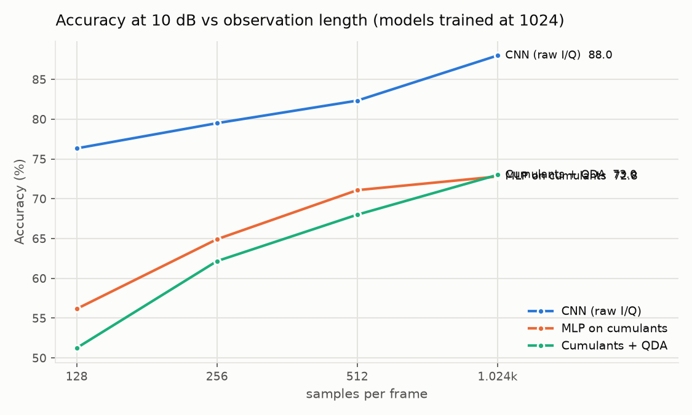
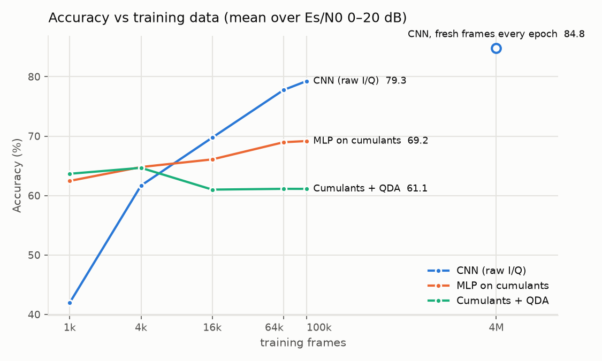
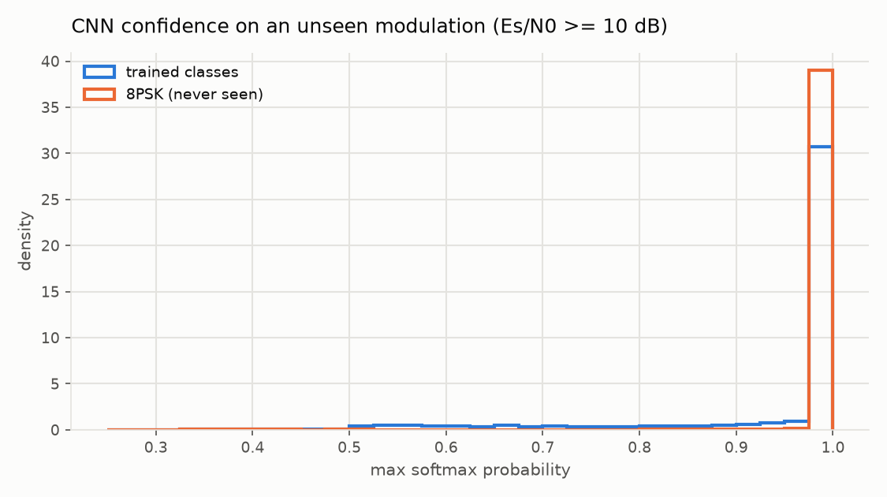

# Where a learned modulation classifier helps, and where it does not

This report compares a 1-D CNN on raw I/Q samples with classical higher-order-cumulant classifiers.
Both are tested on the same synthetic channel: Rician fading, carrier frequency offset, timing offset
and AWGN. Every number comes from `scripts/run_experiments.py` and is stored in
`results/results.json`, and `scripts/make_tables.py` renders the tables from that file. Each model
was trained once, on one arm64 Mac (PyTorch 2.14.1, MPS backend). The [limitations](#limitations)
section says how much weight the numbers can bear.

SNR is always **Es/N0, the energy per symbol**. At 2 samples per symbol, a dataset that quotes
SNR per sample calls the same frame 3 dB less, so 10 dB here equals 7 dB per-sample SNR.

## Summary

| | CNN (raw I/Q) | Best classical method |
|---|---:|---:|
| Accuracy at Es/N0 = 10 dB | **88.0%** | 73.0% (cumulants + QDA) |
| Mean accuracy over Es/N0 0–20 dB | **84.8%** | 69.2% (MLP on cumulants) |
| Accuracy at Es/N0 = 20 dB | **98.6%** | 89.8% (MLP on cumulants) |
| Es/N0 at which accuracy first reaches 90% | 12 dB (91.8%) | 18 dB (MLP, 91.1%) |

**Where the CNN helps**

- **Noise.** It leads at every Es/N0 from −10 to 20 dB, by 15 points at 10 dB. It reaches about
  75% at 4 dB. The MLP and the analytic rule (which is given the true SNR) need about 11 dB for
  the same accuracy, and QDA never gets there.
- **Short observations.** With 128 samples (64 symbols) it scores 76.3% at 10 dB. Both classical
  methods score less with eight times as many samples (72.8% and 73.0% at 1024).
- **The hard pair.** 16QAM and 64QAM are where cumulants run out. At 10 dB the CNN gets 78.8% and
  75.6% on them. QDA gets 75.0% and 40.6%, and the MLP 16.2% and 89.2%.
- **Fading it was not trained on.** Rayleigh fading (no line of sight) costs it 3.3 points, and
  10× faster fading 1.5 points (mean over 0–20 dB). For QDA the costs are 3.1 and 5.9, and for the
  MLP 4.1 and 5.1.
- **Calibration on familiar data.** Its expected calibration error is 0.007. When it says 90%, it
  is right about 90% of the time, but only on the classes and channel it was trained on.

**Where it does not**

- **Impairments outside its training range.** With 10× the training frequency offset, its mean
  accuracy drops from 84.8% to 67.9%, and to 70.6% at 10 dB. At 10 dB that is below both classical
  methods (73.2% and 72.1%). They estimate and remove the offset blindly, so they are unaffected.
- **A different pulse shape.** A roll-off of 0.2 instead of 0.35 costs the CNN 4.9 points. The
  classical methods change by less than one point.
- **A modulation it has never seen.** It labels 8PSK as QPSK 99.3% of the time, with mean
  confidence 0.991. That is *higher* than its confidence on the classes it knows (0.940). Its
  max-softmax score cannot raise an alarm: the AUROC is 0.411, worse than chance. The QDA
  likelihood flags 8PSK with AUROC 0.960.
- **Small training sets.** With 1,000 training frames the CNN averages 42.0%, against 63.7% for
  QDA. It catches up somewhere between 4,000 and 16,000 frames, while the classical methods are
  near their best at 1,000.
- **Compute.** The CNN has 399,108 parameters and needs 52.7 M multiply-accumulates per frame.
  QDA has 144 parameters and needs about 1 M operations. On a CPU the CNN's best case is 0.32 ms
  per frame (at batch 8), against 0.14 ms for the whole classical pipeline. On the GPU it takes
  0.036 ms.

## 1. Setup

The [README](README.md) describes the signal chain and the models. In short:

- **Signals.** Four classes (BPSK, QPSK, 16QAM, 64QAM). Each frame has 1024 samples at 2 samples
  per symbol, with root-raised-cosine pulses (β = 0.35). The channel adds flat Rician fading
  (K ~ U[0, 10] dB, normalised Doppler up to 2·10⁻⁴), a residual frequency offset of up to
  ±10⁻³ of the sample rate, a random phase, a fractional timing offset and AWGN. Es/N0 runs from
  −10 to 20 dB in 2 dB steps.
- **CNN.** Trained for 40 epochs with AdamW and a one-cycle learning rate (peak 2·10⁻³), batch
  size 256. Each epoch uses **100,000 newly generated frames**, so the CNN sees 4 M distinct
  frames in total. The checkpoint with the best accuracy on 8,000 validation frames is kept.
- **Classical baselines.** Trained on the features of a fixed 100,000-frame set. More data does
  not help them: they are near their best at 1,000 frames (section 7).
- **Test set.** A separate seed, balanced across the grid: 500 frames per class at every Es/N0
  (2,000 per Es/N0). At 88% accuracy, the sampling error of one number is about ±0.7 points
  (one standard error).

## 2. Accuracy against noise


| Es/N0 (dB) | CNN (raw I/Q) | MLP on cumulants | Cumulants + QDA | Analytic rule (genie SNR) |
|---:|---:|---:|---:|---:|
| −10 | 31.9 | 26.2 | 24.8 | 24.6 |
| −6 | 42.3 | 25.5 | 25.2 | 24.7 |
| −2 | 55.1 | 27.0 | 25.4 | 25.1 |
| 0 | 60.2 | 30.9 | 27.4 | 29.3 |
| 2 | 67.6 | 40.6 | 34.5 | 36.1 |
| 4 | 74.7 | 51.9 | 47.7 | 46.0 |
| 6 | 78.0 | 61.1 | 59.5 | 57.0 |
| 8 | 83.2 | 68.2 | 68.0 | 63.9 |
| 10 | **88.0** | 72.8 | 73.0 | 72.2 |
| 12 | 91.8 | 78.8 | 72.4 | 76.0 |
| 14 | 95.0 | 86.1 | 73.2 | 82.5 |
| 16 | 96.9 | 89.6 | 73.0 | 85.0 |
| 18 | 98.5 | 91.1 | 72.8 | 87.6 |
| 20 | 98.6 | 89.8 | 71.0 | 87.6 |
| **mean 0–20 dB** | **84.8** | **69.2** | **61.1** | **65.8** |

The full table, with every 2 dB step, is in `results/tables.md`.

Three things stand out:

- **Below 0 dB the classical methods are at chance (25%); the CNN is not.** Cumulants estimated
  from 512 noisy symbols are dominated by noise there. The CNN still reaches 60.2% at 0 dB.
- **QDA stops improving at about 73% above 10 dB.** It fits one Gaussian per class over the whole
  SNR range. The cumulants of 16QAM and 64QAM move with SNR, so one Gaussian cannot keep them
  apart. The MLP uses the *same seven features* and keeps improving to 91%, so the plateau comes
  from the decision rule, not from the features.
- **Even with the true SNR, the analytic rule stops at 87.6%, while the CNN reaches 98.6%.** At
  20 dB the amplitude rings of the constellations are clearly visible in the raw samples. A few
  fourth- and sixth-order statistics are a lossy summary of them. Our reading is that the CNN uses
  that extra structure, but we did not probe the network to check.

## 3. Where the errors are



| Method | BPSK | QPSK | 16QAM | 64QAM |
|---|---:|---:|---:|---:|
| CNN (raw I/Q) | 99.8 | 97.8 | 78.8 | 75.6 |
| MLP on cumulants | 94.2 | 91.6 | 16.2 | 89.2 |
| Cumulants + QDA | 94.2 | 82.2 | 75.0 | 40.6 |
| Analytic rule (genie SNR) | 83.8 | 76.0 | 53.0 | 76.2 |

At 10 dB nearly all of the CNN's errors are 16QAM confused with 64QAM. Of 500 16QAM frames, 99
are called 64QAM, and 117 of 500 64QAM frames are called 16QAM. It splits the errors fairly
evenly. The classical methods do not:

- The MLP sends 392 of 500 16QAM frames to 64QAM.
- QDA sends 293 of 500 64QAM frames to 16QAM.

Their average accuracy hides a strong bias towards one class.

## 4. Calibration



The CNN's expected calibration error on the test set is **0.007**, so its stated confidence
matches its accuracy. The first training run, on a fixed dataset, had an ECE of 0.105 (see
[History](#history-the-first-run)). This is calibration on familiar data only. Section 8 shows the
same model being confidently wrong on a modulation it has not seen.

## 5. A different channel at test time

Every model was trained on the default channel and then tested on altered ones, without
retraining.



| Test channel | CNN: at 10 dB / mean | MLP: at 10 dB / mean | QDA: at 10 dB / mean |
|---|---:|---:|---:|
| trained channel | 88.0 / 84.8 | 72.8 / 69.2 | 73.0 / 61.1 |
| AWGN only | 89.4 / 87.3 | 73.7 / 73.7 | 77.0 / 64.1 |
| Rayleigh (no line of sight) | 84.6 / 81.5 | 67.4 / 65.1 | 63.7 / 58.0 |
| fast fading (10× Doppler) | 85.2 / 83.3 | 71.0 / 64.1 | 63.2 / 55.2 |
| **large CFO (10×)** | **70.6 / 67.9** | 73.2 / 69.4 | 72.1 / 61.3 |
| roll-off 0.2 (unseen) | 82.9 / 79.9 | 72.7 / 68.7 | 72.6 / 61.8 |

(1,200 frames per Es/N0; "mean" is over 0–20 dB.)

- **The CNN handles fading changes as well as the classical methods, or better.** The fading in
  training covered a range of K-factors and Doppler, and the network generalises across that kind
  of variation.
- **A frequency offset beyond the training range erases its whole lead.** The training data had
  offsets up to ±10⁻³ of the sample rate; this test uses up to ±10⁻². The classical front end
  estimates the offset from the spectral line of x⁴ and removes it before computing any feature,
  so it does not notice the change. The CNN never learned to undo rotations that fast.
- **A sharper pulse (roll-off 0.2) costs the CNN 4.9 points and the classical methods almost
  nothing.** The CNN learned the training pulse shape as part of what each class looks like.

**Trained on AWGN only, tested on fading.** A second set of models was trained without fading.

| Test set | CNN: at 10 dB / mean | MLP: at 10 dB / mean | QDA: at 10 dB / mean |
|---|---:|---:|---:|
| AWGN | 85.8 / 85.0 | 73.7 / 73.3 | 84.2 / 64.6 |
| Rician fading | 82.5 / 78.6 | 72.6 / 68.2 | 74.4 / 61.5 |

All three lose accuracy when fading appears: the CNN 6.4 points (mean), the MLP 5.1 and QDA 3.1.
This CNN had a smaller budget than the main one (60,000 new frames per epoch for 20 epochs,
against 100,000 for 40), so compare its two rows with each other, not with the main model.

## 6. Shorter observations

All models were trained on 1024-sample frames and tested on shorter ones.



| Samples per frame | CNN: at 10 dB / mean | MLP: at 10 dB / mean | QDA: at 10 dB / mean |
|---|---:|---:|---:|
| 128 | 76.3 / 73.3 | 56.2 / 50.6 | 51.2 / 42.8 |
| 256 | 79.5 / 77.9 | 64.9 / 59.8 | 62.2 / 51.3 |
| 512 | 82.3 / 81.3 | 71.1 / 65.9 | 68.0 / 57.7 |
| 1024 | 88.0 / 84.8 | 72.8 / 69.2 | 73.0 / 61.1 |

Cumulant estimates get noisier as the frame gets shorter. From 1024 to 128 samples the classical
methods lose 17 to 22 points at 10 dB; the CNN loses 12. With 128 samples it still beats both classical
methods at 1024. This matters wherever a decision has to be made from a short burst.

## 7. Training data, and why the first run overfitted

Each point on the lines below is a model trained on a **fixed** set of that size. The CNN got
max(20, 800,000 / n) epochs. The hollow marker is the final CNN, which saw a new set of 100,000
frames in each of its 40 epochs (4 M frames in total).



| Training frames (fixed set) | CNN: at 10 dB / mean | MLP: at 10 dB / mean | QDA: at 10 dB / mean |
|---|---:|---:|---:|
| 1,000 | 45.4 / 42.0 | 69.3 / 62.5 | 72.0 / 63.7 |
| 4,000 | 66.0 / 61.7 | 71.8 / 64.8 | 75.1 / 64.7 |
| 16,000 | 73.5 / 69.8 | 70.8 / 66.1 | 72.0 / 61.0 |
| 64,000 | 81.3 / 77.8 | 73.5 / 69.0 | 72.5 / 61.1 |
| 100,000 (first run, 30 epochs) | 82.6 / 79.3 | 72.8 / 69.2 | 73.0 / 61.1 |
| new 100,000 every epoch (final) | **88.0 / 84.8** | — | — |

- **QDA has 144 parameters and has learned all it can from 1,000 frames.** The MLP gains about 7
  points (mean) from 1,000 to 100,000 frames.
- **The CNN is worse than either until somewhere between 4,000 and 16,000 frames.** It is still
  improving at 100,000.
- **Even 100,000 fixed frames were not enough for 399,108 parameters.** In the first run,
  training accuracy reached 96.5% while validation accuracy peaked at 67.2%. Both are measured
  over all SNRs from −10 to 20 dB, where the final model averages about 72%. Generating new frames every epoch
  removed the gap: training accuracy was 71.2% and validation accuracy 72.1% at the end. Test
  accuracy at 10 dB rose from 82.6% to 88.0%.

Synthetic data made that fix free. Over the air, 16,000 or more labelled frames per channel
condition is a real cost.

## 8. A modulation it has never seen

8PSK was never in training. These are its test frames at Es/N0 ≥ 10 dB, 6,000 frames in all.



| | CNN |
|---|---:|
| 8PSK labelled as QPSK | 99.3% |
| Mean max-softmax confidence on 8PSK | 0.991 |
| Mean max-softmax confidence on the four trained classes | 0.940 |
| 8PSK frames with confidence > 0.9 | 98.2% |

| Out-of-distribution score | AUROC (0.5 = chance) |
|---|---:|
| CNN max-softmax | 0.411 |
| QDA maximum log-likelihood | 0.960 |

A classifier with a closed set of classes has to put every input somewhere. The worrying part is
not that the CNN calls 8PSK "QPSK" but that it is *more* sure about it than about real QPSK.
Thresholding the softmax would pass almost every 8PSK frame.

The classical features make the difference visible. QPSK and 8PSK share |C42| = 1, but |C40| is 1
for QPSK and 0 for 8PSK. 8PSK therefore lands far from every class's Gaussian in feature space,
and its likelihood under QDA is low. The CNN probably keys on cues the two share, such as the
constant envelope; we did not probe it to confirm.

**Better training does not fix this.** The overfitted first run gave the same result: 99.1% as
QPSK and AUROC 0.366.

## 9. Cost

| | CNN | Cumulants + QDA |
|---|---:|---:|
| Trainable parameters | 399,108 | 144 |
| Arithmetic per frame | 52.7 M multiply-accumulates (counted) | ≈ 1 M floating-point operations (estimated; the 8192-point FFT for CFO estimation and the 4× resampling FFTs dominate) |
| CPU time per frame, batch 1 | 0.87 ms | — |
| CPU time per frame, batch 256 | 3.06 ms | 0.14 ms (features + QDA) |
| GPU (MPS) time per frame, batch 256 | 0.036 ms | — |

On the CPU, the cost per frame does not fall steadily with batch size. This sweep was run with
`scripts/cpu_latency_sweep.py` (5 threads; results in `results/cpu_latency.json`):

| Batch size | 1 | 2 | 4 | 8 | 16 | 32 | 64 | 128 | 256 |
|---|---:|---:|---:|---:|---:|---:|---:|---:|---:|
| ms per frame | 0.88 | 0.63 | 0.45 | **0.32** | 6.48 | 4.85 | 3.90 | 3.40 | 3.16 |

From batch 8 to batch 16 the cost per frame jumps twentyfold. This is not oneDNN, which is not
available in this PyTorch build. It is not threading either: the jump is the same with one
thread. PyTorch's CPU convolution chooses a different kernel depending on the input shape; we did
not look further. The practical point: on a CPU, a 50 M-MAC model's latency depends on the
deployment's batch shape, so that shape has to be benchmarked. Measurements are from one machine.

The sample rate in this study is normalised, so these times cannot be turned into a real-time
budget without fixing a bandwidth.

## 10. What this means for AI-native air interfaces in 6G

Proposals for 6G put learned models inside the receiver chain. 3GPP's Release 18 study on AI/ML
for the NR air interface (TR 38.843) looked at CSI feedback, beam management and positioning. It
identified generalisation across scenarios, model monitoring and life-cycle management as central
problems. Modulation classification is not one of those use cases, but it is a small, fully
controlled testbed for the same questions. The results suggest five things:

1. **Learn what the model-based method only summarises; keep model-based processing where it is
   exact and cheap.** Cumulants throw away information, and the CNN recovers it (sections 2, 3
   and 6). Blind frequency-offset estimation is exact and cheap, and it is exactly where the CNN
   failed (section 5). A hybrid would be the obvious design: classical synchronisation first, then
   the network. *We did not test this; it is the natural next experiment.*
2. **The training distribution is the specification.** The CNN generalised across fading
   conditions it had seen versions of. It broke on a frequency-offset range and a pulse shape it
   had not seen. Every impairment range the model may meet in deployment has to be in the training
   data, or be detected.
3. **Out-of-distribution detection has to be designed in.** Max-softmax was worse than useless
   (AUROC 0.411), and good calibration on familiar data did not help. A density score on
   interpretable features worked (0.960). A deployed learned receiver needs a monitor like that
   and a classical fallback path for when it fires.
4. **Data is the real cost.** The CNN needed between 4,000 and 16,000 labelled frames to match a
   144-parameter model, and kept improving up to millions of frames. That is free in simulation
   and expensive over the air. This study does not measure the gap between simulation and
   real-world data.
5. **Compute is affordable on an accelerator and unpredictable on a CPU.** It is 50 to 100 times
   the arithmetic of the classical pipeline (52.7 M multiply-accumulates against about 1 M
   operations). At the right batch size the CPU time per frame is only
   2.3× higher, but at the wrong one it is 46× higher (section 9).

## Limitations

- **Synthetic data only.** Flat fading on a single carrier: no multipath intersymbol
  interference, phase noise, IQ imbalance, amplifier non-linearity or OFDM.
- **Four classes.** Only 8PSK is used as an unseen class.
- **One training run per model.** We did not measure how much the results vary with the training
  seed. The test-set sampling error is about ±0.7 points (one standard error) for one number on
  the main grid. It is about ±1 point on the channel-shift and frame-length grids, and ±1.9 points
  for a per-class number. Differences under about 2 points are not meaningful.
- **The analytic rule is given the true SNR.** Every other method estimates everything from the
  frame.
- **Limited tuning.** The CNN's hyper-parameters were chosen by hand, using the validation set. The
  classical front end was checked against textbook cumulants (unit tests) but not tuned further.
- **Timings come from one machine.**

## History: the first run

The first full run trained the CNN on one fixed set of 100,000 frames for 30 epochs. It overfitted
(section 7): 82.6% at 10 dB, 79.3% mean, ECE 0.105. The fix was `amc.dataset.FreshData`, which
generates a new set every epoch in worker processes and prefetches the next epoch during training.
The classical baselines gave the same numbers in both runs, as they use the same features and
seeds, so the change affected only the CNN. The first run's outputs are kept in
`results/results_fixed_dataset.json` and `results/run_fixed_dataset.log`.

## Reproduce

```bash
pip install -e ".[test]"
python scripts/run_experiments.py      # ~32 min on an Apple-silicon GPU (MPS); writes results/, figures/, models/
python scripts/make_tables.py > results/tables.md
python scripts/cpu_latency_sweep.py    # the CPU batch-size table in section 9
```

Data generation is seeded, so every dataset is identical on every machine. GPU training is not
bit-for-bit deterministic, so CNN numbers can differ slightly between runs and machines.
